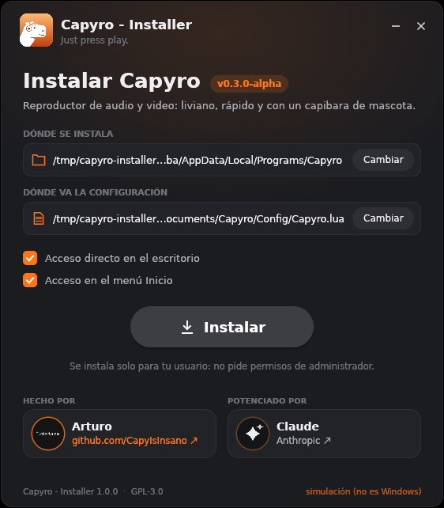
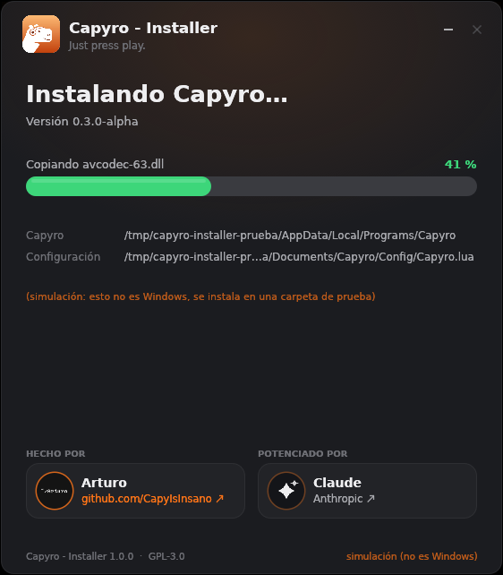

<div align="center">


# Capyro - Installer

**El instalador de [Capyro](https://github.com/CapyIsInsano/Capyro) para Windows 10 y 11.**<br>
Con la misma cara que Capyro: elegís dónde va, tocás **Instalar** y listo. *Just press play.*


</div>

<table>
<tr>
<td width="33%" align="center"><br><sub><b>Elegís</b> dónde va Capyro y su configuración</sub></td>
<td width="33%" align="center"><br><sub><b>Barra verde</b> con lo que se está copiando</sub></td>
<td width="33%" align="center"><br><sub><b>¿Lanzar Capyro?</b> Sí o No</sub></td>
</tr>
</table>

<sub>Capturas de la interfaz compilada para Linux (modo simulación, por eso las rutas en `/tmp`). En Windows las rutas son las de abajo.</sub>

## Cómo se usa

1. Bajá **`CapyroInstaller.exe`** de [Releases](../../releases/latest) y abrilo.
2. Fijate **dónde se instala** y **dónde va la configuración**. Si querés otro lugar, tocá **Cambiar**.
3. Tocá **Instalar** (el botón gris que se pone amarillo cuando le pasás el mouse) y mirá la barra verde.
4. Al terminar te dice **qué versión de Capyro se instaló** y te pregunta **¿Lanzar Capyro?**
   - **Sí** → se cierra el instalador y se abre Capyro por primera vez (con su tutorial).
   - **No** → se cierra el instalador.
5. Listo: **ya podés borrar el instalador**. Capyro no lo necesita para andar.

No pide permisos de administrador: se instala solo para tu usuario.

> [!IMPORTANT]
> El `.exe` no está firmado, así que la primera vez **SmartScreen** puede decir
> *"Windows protegió tu PC"*: tocá **Más información → Ejecutar de todas formas**.

## Qué hace

| | Por defecto |
|---|---|
| **Capyro** (capyro.exe, las DLL de FFmpeg) | `%LOCALAPPDATA%\Programs\Capyro` |
| **Configuración** (`Capyro.lua`) | `Documentos\Capyro\Config\Capyro.lua` |
| **Accesos directos** | Escritorio y menú Inicio (se pueden destildar) |
| **"Abrir con…"** | Capyro aparece para mp4, mov, avi, mp3, wav, ogg y aac (sin adueñarse de ninguno; para usarlo por defecto: Configuración → Aplicaciones predeterminadas → Capyro) |
| **Desinstalar** | Configuración → Aplicaciones → Capyro (o `uninstall.exe --uninstall`) |

- La configuración se crea con **`system = "Win"`**: así Capyro sabe que es la versión de
  Windows y, al actualizarse, baja e instala solo lo de Windows.
- Si ya tenías una configuración en ese lugar **no se pisa** (tus atajos quedan).
- La ruta de la configuración queda anotada en `capyro-config.txt`, al lado de `capyro.exe`:
  Capyro la lee de ahí. Si la querés mover, cambiá esa línea.
- Si Capyro está abierto mientras instalás encima, los archivos en uso se renombran a `.old`
  y Capyro los borra solo la próxima vez que abre.
- Al desinstalar se borran el programa, los accesos directos y la entrada de Aplicaciones.
  **Tu configuración, tus listas y tus capturas quedan.**

## Online u offline

- **Offline** (el de Releases): trae Capyro adentro. Se arma poniendo
  `capyro-windows-x64.zip` en [`payload/`](payload/) antes de compilar.
- **Online**: si se compila sin ese archivo, al instalar baja la última versión para Windows
  publicada en el repo de Capyro (release `windows`, la arma su CI).

## Compilar

Desde Linux (como lo hace el CI), con mingw-w64 y el target de Rust para Windows:

```sh
sudo apt install mingw-w64            # o el paquete de tu distro
rustup target add x86_64-pc-windows-gnu
# opcional: el paquete de Capyro adentro (instalador offline)
gh release download windows --repo CapyIsInsano/Capyro --pattern capyro-windows-x64.zip --dir payload
CARGO_TARGET_X86_64_PC_WINDOWS_GNU_LINKER=x86_64-w64-mingw32-gcc \
    cargo build --release --target x86_64-pc-windows-gnu
# → target/x86_64-pc-windows-gnu/release/CapyroInstaller.exe
```

En Windows: desde MSYS2 (UCRT64), con Rust para `x86_64-pc-windows-gnu`, alcanza con
`cargo build --release` (el ícono y el manifiesto se compilan con el `windres` de MSYS2).

En Linux también compila (`cargo run --release`), pero en **modo simulación**: instala en
una carpeta de prueba en `/tmp` y no toca nada del sistema. Sirve para trabajar en la interfaz.

`cargo test` prueba la parte de instalar (descomprimir, la config con `system = "Win"`,
renombrar lo que está en uso).

## Créditos

Hecho por **[Arturo](https://github.com/CapyIsInsano)**. Potenciado por **[Claude](https://www.anthropic.com/claude)** · Anthropic.<br>
Licencia **GPL-3.0**, como Capyro.
